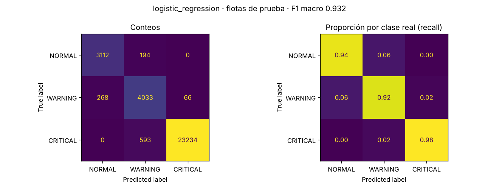

# Comparación de modelos

Generado por `ml/train_model.py` el 2026-10-28T03:34:19+00:00 (Python 3.13.18, scikit-learn 1.9.1).

- Datos: 105000 filas de 30 flotas (`data/training.csv`).
- Separación por flota con `GroupShuffleSplit(test_size=0.25, random_state=606)`: 22 flotas de entrenamiento y 8 de prueba, sin flotas compartidas.
- Selección con `GroupKFold(5)` sobre las flotas de entrenamiento; métrica F1 macro.
- Los tres clasificadores usan `class_weight="balanced"` porque CRITICAL es cerca del 74 % de los datos.

## Resultados

| modelo | variables | cv_f1_macro_media | cv_f1_macro_desv | prueba_f1_macro | prueba_accuracy | segundos |
|---|---|---|---|---|---|---|
| baseline_mayoritaria | completo | 0.282 | 0.015 | 0.287 | 0.756 | 0.700 |
| logistic_regression | completo | 0.923 | 0.011 | 0.933 | 0.965 | 2.900 |
| logistic_regression | sin_battery | 0.922 | 0.011 | 0.932 | 0.965 | 3.000 |
| logistic_regression | sin_battery_obstacle | 0.922 | 0.011 | 0.932 | 0.964 | 3.100 |
| hist_gradient_boosting | completo | 0.922 | 0.010 | 0.930 | 0.964 | 22.300 |
| hist_gradient_boosting | sin_battery | 0.921 | 0.011 | 0.930 | 0.964 | 15.800 |
| hist_gradient_boosting | sin_battery_obstacle | 0.920 | 0.012 | 0.931 | 0.965 | 13.500 |
| random_forest | completo | 0.920 | 0.012 | 0.929 | 0.964 | 43.700 |
| random_forest | sin_battery | 0.919 | 0.011 | 0.930 | 0.964 | 42.900 |
| random_forest | sin_battery_obstacle | 0.920 | 0.011 | 0.929 | 0.963 | 40.800 |

## Modelo elegido

**logistic_regression** con variables **sin_battery_obstacle**: speed, motor_temp, vibration, motor_current.

- F1 macro en validación cruzada: 0.922 ± 0.011.
- F1 macro en las flotas de prueba: 0.932 (línea base de clase mayoritaria: 0.287).
- Mejor resultado bruto en validación cruzada: logistic_regression / completo (0.923). Umbral de empate: 0.912.
- Latencia de `predict_proba` para una fila en el equipo de entrenamiento: P50 2.963 ms, P95 4.413 ms (300 repeticiones). No incluye red ni servidor.

### Matriz de confusión (flotas de prueba)



```
              precision    recall  f1-score   support

      NORMAL      0.921     0.941     0.931      3306
     WARNING      0.837     0.924     0.878      4367
    CRITICAL      0.997     0.975     0.986     23827

    accuracy                          0.964     31500
   macro avg      0.918     0.947     0.932     31500
weighted avg      0.967     0.964     0.965     31500
```
