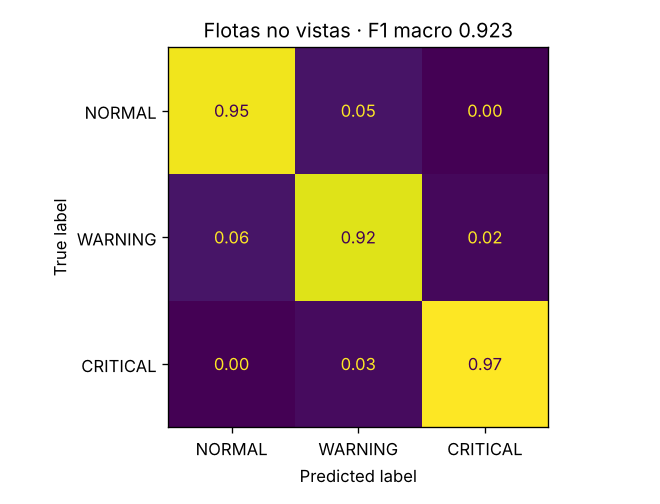

# Evaluación en flotas no vistas

Generado por `ml/evaluate_unseen.py` el 2026-10-28T03:34:27+00:00 con el modelo `logistic_regression` (v1, variables: speed, motor_temp, vibration, motor_current).

36500 filas de 10 flotas con semillas reservadas, que no se usaron para entrenar ni para elegir el modelo.

- **F1 macro del modelo: 0.923**
- F1 macro de la línea base (siempre CRITICAL): 0.297

## Por flota

| flota | robots | pasos | filas | % CRITICAL | F1 modelo | F1 línea base |
|---|---|---|---|---|---|---|
| 9001 | 4 | 250 | 1000 | 79.2 | 0.892 | 0.295 |
| 9002 | 4 | 625 | 2500 | 83.0 | 0.864 | 0.302 |
| 9003 | 4 | 1250 | 5000 | 91.2 | 0.899 | 0.318 |
| 9004 | 4 | 2000 | 8000 | 83.4 | 0.913 | 0.303 |
| 9005 | 6 | 166 | 1000 | 40.3 | 0.896 | 0.191 |
| 9006 | 6 | 416 | 2500 | 72.0 | 0.959 | 0.279 |
| 9007 | 6 | 833 | 5000 | 82.6 | 0.915 | 0.302 |
| 9008 | 6 | 1333 | 8000 | 93.1 | 0.902 | 0.321 |
| 9009 | 12 | 83 | 1000 | 42.9 | 0.873 | 0.2 |
| 9010 | 12 | 208 | 2500 | 38.1 | 0.932 | 0.184 |

## Según el avance de la simulación

| tramo | filas | F1 modelo |
|---|---|---|
| 0-25 % | 9142 | 0.916 |
| 25-50 % | 9112 | 0.908 |
| 50-75 % | 9126 | 0.919 |
| 75-100 % | 9120 | 0.921 |

## Detalle por clase

```
              precision    recall  f1-score   support

      NORMAL      0.933     0.948     0.941      3255
     WARNING      0.780     0.924     0.846      3980
    CRITICAL      0.997     0.970     0.984     29265

    accuracy                          0.963     36500
   macro avg      0.903     0.947     0.923     36500
weighted avg      0.968     0.963     0.965     36500
```


